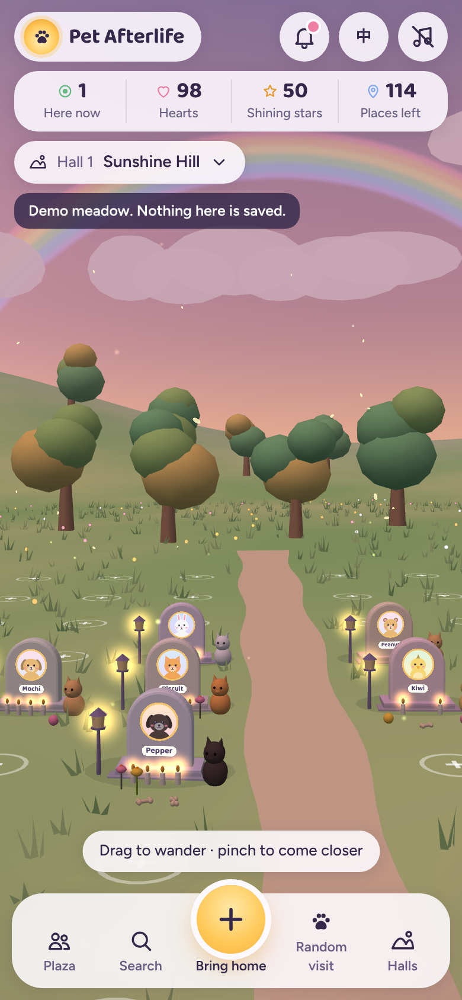

# Pet Afterlife

A virtual memorial meadow where pet owners give a pet who has crossed the rainbow bridge a place of its own. Visitors light candles, leave flowers, sign guestbooks and share letters with others who feel the same loss.

- `index.html` — the whole app in one file (Three.js 3D meadow, five halls, pet profiles, plaza, EN/中文)
- `docs/SPEC.md` — the build spec
- `docs/screenshots/` — mobile and desktop previews

It runs as a claude.ai artifact and stores memorials through the artifact `db` capability. Opened anywhere else, it runs in a labelled demo mode with sample pets.

